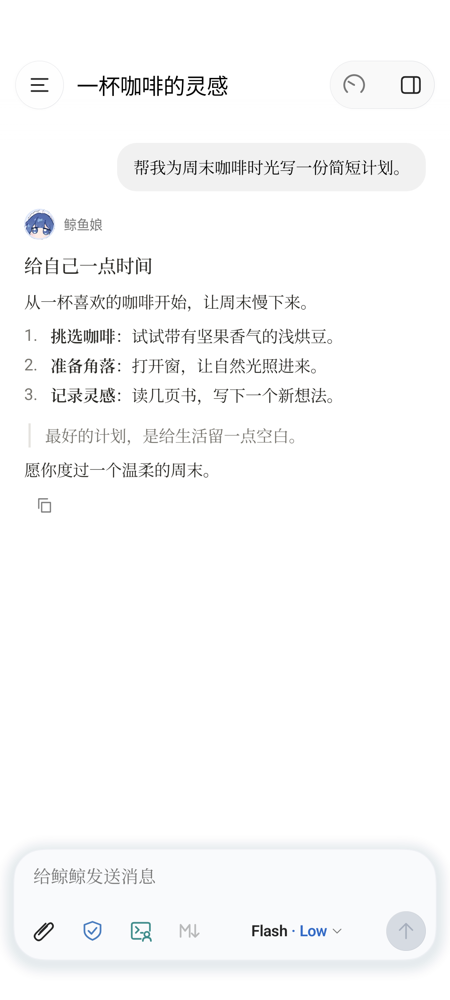
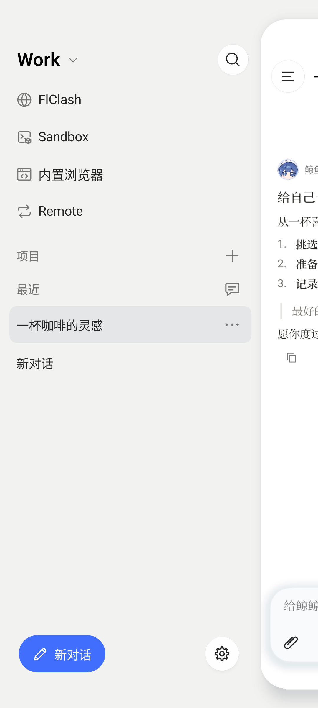
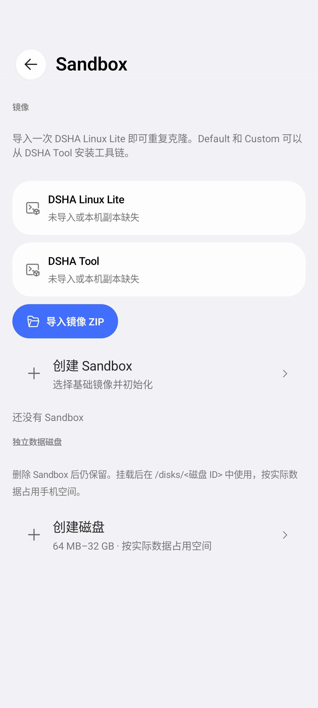

<div align="center">
  

  # Deepseek Harness on Android

  **在 Android 上使用 DeepSeek Harness 的助手与工作空间**

  Android 11 及以上（API 30+） · ARM64 · [下载最新版本](https://github.com/FengGJSNW/Deepseek-Harness-on-Android/releases/latest)
</div>

## 声明

**Deepseek Harness on Android（DSHA）是由个人开发者独立开发和维护的开源项目，目前仍处于早期开发阶段。** 由于个人时间、精力及测试设备有限，软件可能存在 Bug、功能缺失、兼容性问题或其他未预见的风险，无法保证所有功能的稳定性、安全性与及时维护。

欢迎通过 GitHub Issues 反馈问题、提出建议或提交改进方案。开发者会在时间和能力允许的情况下逐步处理，但不承诺具体的修复时间、更新频率或持续维护义务。

### 使用风险与责任

- **Shell / Root 权限**：本软件提供 Shell、Shizuku、Root 等高级系统操作能力。相关功能可能修改系统文件、执行命令或访问敏感数据。用户应充分理解操作风险，并自行决定是否授予相关权限。因用户自行执行命令、不当配置、授权 Agent 执行危险操作等造成的设备异常、数据丢失、系统损坏或其他损失，由用户自行承担相应责任。
- **自动化与 Agent 行为**：本软件包含由 AI Agent 调用工具、执行任务及操作设备的功能。AI 生成的内容和操作可能存在错误，用户应自行审查高风险操作并合理控制权限。开发者不保证 AI 行为的准确性、可靠性或安全性。
- **FlClash 与网络功能**：本项目集成了开源项目 FlClash 及相关网络代理功能。相关功能仅作为通用网络技术工具提供，不代表开发者鼓励、支持或授权任何违法违规用途。用户应自行了解并遵守所在国家或地区的法律法规。因用户自行配置、使用网络代理或访问相关服务而引发的法律责任及其他后果，应由实际行为人依法承担。
- **第三方服务**：本软件涉及第三方模型 API、网络服务及开源组件。相关服务的可用性、收费政策、隐私处理及使用限制由对应服务提供方决定，用户应自行遵守其服务条款。

### 第三方版权与素材

本项目使用或参考了部分第三方开源代码、UI 组件、字体、图片及其他美术素材。开发者尊重原创作者的知识产权，并尽可能在项目中保留相关许可及来源说明。

如您认为本项目中的任何内容侵犯了您的合法权益，欢迎通过 GitHub Issues 联系开发者，并提供相关作品及权利归属信息。经核实后，开发者将在合理范围内尽快删除、替换相关素材或采取其他适当措施。

项目中第三方组件的使用、修改及再分发仍应遵守其原有开源许可证，具体信息请参阅 [NOTICE.md](NOTICE.md) 及相关许可文件。

### 其他说明

本软件按**“现状”（AS IS）**提供，不附带任何明示或默示的担保，包括但不限于适销性、特定用途适用性及不侵权保证。

**在适用法律允许的最大范围内**，开发者不对因使用或无法使用本软件而产生的直接或间接损失承担超出法律规定的责任。本声明不排除或限制依法不得排除或限制的责任。

下载、安装或使用本软件前，请充分了解相关功能及潜在风险。

## 界面预览

以下为一些截图....

| 会话与 Markdown | 会话侧栏 | Sandbox 管理 |
| :---: | :---: | :---: |
|  |  |  |

## 主要功能

- **会话与任务**：Work 会话支持 DeepSeek API、自定义任务模式、任务进度、Markdown、代码和数学内容渲染；Chat 可连接 DeepSeek 官方网页。模型服务需要用户自行配置或登录。
- **DSHA Sandbox**：在应用中管理独立的 Linux 虚拟环境、磁盘和会话访问授权。Sandbox 使用 v86 和 Alpine x86；虚拟机里的 root 不等同于 Android 系统 root。安装包不预装镜像，可按下文导入 ZIP。
- **内置浏览器**：支持本机网页浏览，以及 DeepSeek 官方搜索和网页读取接口；可在设置中选择提供给 Agent 的浏览器能力。
- **Shell / Root**：终端支持普通应用权限、Shizuku Shell 和 Root 等连接方式。高级权限需要设备环境及用户授权；Sandbox 与手机终端的权限分开管理。
- **扩展与工具**：支持按需安装和管理 Agent Skills、MCP 服务与 JavaScript 插件，也提供工作区文件、项目记忆及任务规划等工具；实际可用范围由用户授权与任务模式决定。
- **集成 FlClash**：内置 FlClash 的代理、配置及 VPN 界面，并扩展 Agent 行为授权与 DSHA 的调用入口。应用还参考和移植了其 `prism_ui` 组件与交互动效。

## 安装与镜像

1. 从 [Releases](https://github.com/FengGJSNW/Deepseek-Harness-on-Android/releases) 下载 Release APK 并安装。应用支持 Android 11 及以上；本次 Release APK 为 ARM64 架构。
2. 如需使用 Sandbox，下载同一版本的 `DSHA-Linux-Lite-0.8.6.zip` 和按需使用的 `DSHA-Tool-0.8.6.zip`，在应用的 **Sandbox → 导入镜像 ZIP** 中选择文件。工具包用于按需提供开发工具，不是独立安装包。
3. 在应用中配置模型服务；需要手机操作时，再按提示开启无障碍服务。Shizuku、Root 和 VPN 功能分别需要对应环境或系统授权。

下载内容的 SHA-256 及源码包见 Release。Sandbox 使用 32 位 x86 软件模拟，功能和性能与原生 Linux 主机不同；它不提供 Docker、GPU 加速或 Android 系统 root。

## 构建

需要 JDK 21、Node.js 24、Android SDK 37、NDK 28.2.13676358、CMake 3.22.1，以及固定版本的 Flutter、Go 和 Rust。FlClash 的源码锁定版本、补丁与构建步骤见 [集成说明](integrations/README.md)。

```powershell
npm ci
node scripts/setup-upstream.mjs
pwsh scripts/setup-flclash.ps1
pwsh scripts/build-flclash.ps1
npm run verify
```

项目不包含发布签名密钥；没有本地发布密钥时，可构建 Debug APK。Sandbox 镜像可通过 `node scripts/prepare-sandbox-bundle.mjs` 和 `python scripts/package-sandbox-images.py --output <目录>` 单独制作。

## 致谢与许可

感谢 [DeepSeek Harness](https://github.com/deepseek-ai/deepseek-harness)、[FlClash](https://github.com/chen08209/FlClash)、[prism_ui](https://github.com/chen08209/prism_ui) 和 [Mihomo](https://github.com/MetaCubeX/mihomo) 的作者与贡献者。DSHA 内置并扩展了 FlClash，也使用和移植了其 UI 组件；相关源码版本与修改见 [集成说明](integrations/README.md)。

项目自有代码按 [GPL-3.0-only](LICENSE) 发布；第三方代码、字体和美术素材分别遵守原有许可。FlClash、prism_ui 与 Mihomo 使用 GPL-3.0；DeepSeek Harness 上游代码使用 MIT。鲸娘图标与部分陪伴素材的授权范围不同于代码许可，来源及使用限制见 [第三方说明](NOTICE.md) 和对应素材的来源文件。
